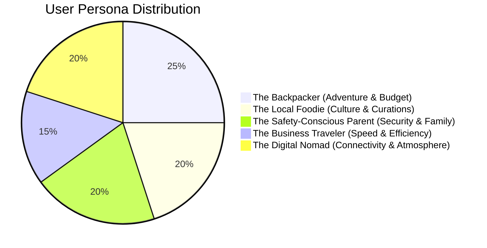
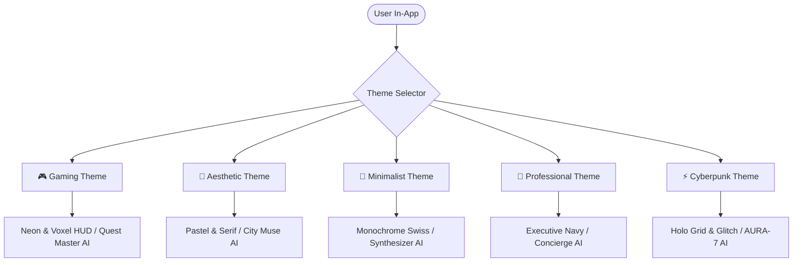
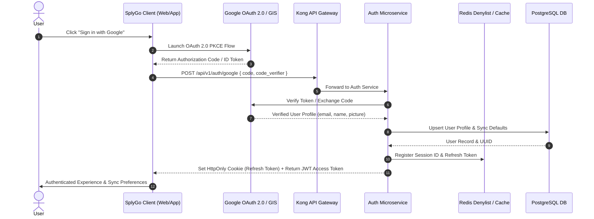
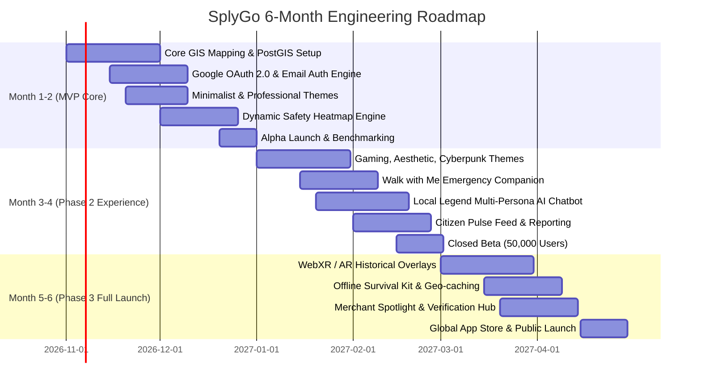
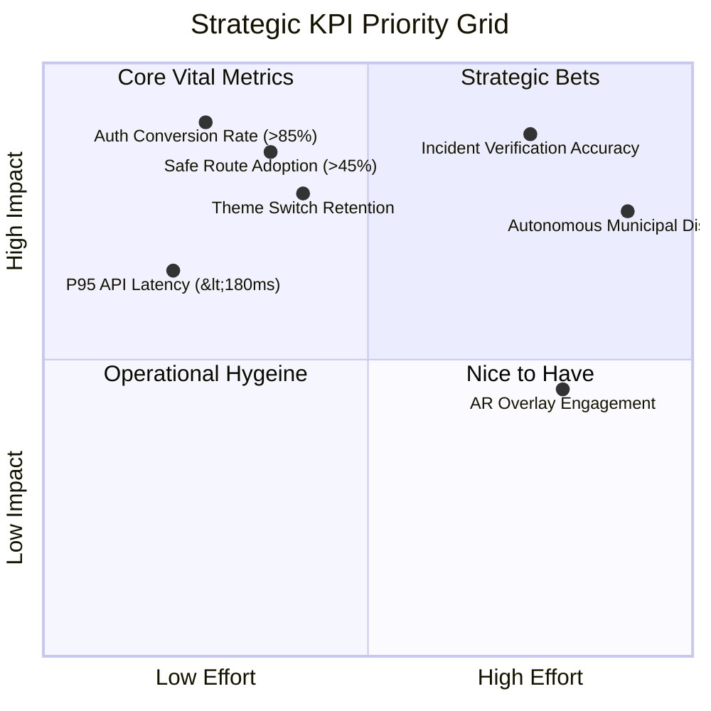

# SplyGo: Exploring, Experiencing & Navigating the Chaos We Call Home
## Comprehensive Product Requirement Document (PRD) & Technical Architecture Blueprint

---

## 1. Executive Summary

**SplyGo** is an intelligent, next-generation urban companion platform engineered to transform chaotic, fragmented city data into verified, hyper-personalized, and life-enhancing decisions. Combining real-time urban informatics with generative spatial intelligence, SplyGo answers the universal urban dilemma: *"I want to go out right now — where should I go, what should I do, and how do I get there safely?"* Unlike traditional mapping applications that treat city streets as sterile lines and pins, SplyGo captures the living pulse of the metropolis — contrasting high-vibe hidden gems against real-time safety heatmaps, historical time-travel overlays, and municipal disruptions. Bolstered by an adaptive **5-Tier Visual & Behavioral Theming Engine** (Gaming, Aesthetic, Minimalist, Professional, and Cyberpunk) and secured by enterprise-grade **Google OAuth 2.0 / Argon2id authentication**, SplyGo empowers explorers, locals, professionals, and families to experience the city on their exact terms while never compromising personal security.

---

## 2. User Personas



### 2.1 Persona 1: The Backpacker — "Leo" (Age 22)
* **Demographics:** Gap-year student, solo traveler, hostel dweller, smartphone native.
* **Psychographics:** High curiosity, extreme budget sensitivity, seeking adrenaline and authentic grassroots subcultures.
* **Goals:** Discover authentic 2 AM street food, off-the-beaten-path hostels, free walking trails, and make friends without falling victim to tourist traps.
* **Pain Points:** Language barriers, fear of getting lost in high-crime zones at night, unpredictable taxi fares, predatory tourist pricing.
* **Preferred Themes:** **Gaming** (for quest XP, unlockable city badges, and treasure-map navigation) or **Minimalist** (to save mobile battery).
* **Key Quote:** *"I don't want the museum everyone takes selfies in; take me to the underground indie music basement down the alley."*

### 2.2 Persona 2: The Local Foodie — "Maya" (Age 29)
* **Demographics:** Creative Director, food photographer, neighborhood resident.
* **Psychographics:** Aesthetic-driven, hyper-attuned to flavors, culinary craft, and ambiance; active on visual social media.
* **Goals:** Track down secret pop-up dinners, unlisted coffee roasteries, and picturesque café patios during golden hour.
* **Pain Points:** Mainstream review platforms inundated with paid sponsorships and outdated opening hours; missing out on limited-batch bakery drops.
* **Preferred Themes:** **Aesthetic** (soft pastels, editorial typography, golden hour light radars, and curated culinary cards).
* **Key Quote:** *"I want to feel the soul and visual warmth of a neighborhood through its culinary artists."*

### 2.3 Persona 3: The Safety-Conscious Parent — "David" (Age 41)
* **Demographics:** Senior Accountant, parent of two (ages 6 and 9), suburban resident visiting downtown.
* **Psychographics:** Highly protective, planned, cautious, values calm predictability, accessibility, and sanitation.
* **Goals:** Find well-lit pedestrian corridors, clean public restrooms, stroller-accessible transit stations, and kid-safe parks.
* **Pain Points:** Unclear safety conditions, broken elevators at subway stations, sudden crowd congestion, lack of clean emergency facilities.
* **Preferred Themes:** **Professional** or **Minimalist** (uncluttered, crisp safety indices, structured data, zero gamified distractions).
* **Key Quote:** *"When I take my children downtown, I need to know five minutes in advance if a block has broken lighting or crowd disturbances."*

### 2.4 Persona 4: The Business Traveler — "Elena" (Age 36)
* **Demographics:** Management Consultant, frequent flyer, works across multiple global metropolitan hubs.
* **Psychographics:** Hyper-busy, punctuality-obsessed, relies on reliable Wi-Fi, expense-account-friendly, values quiet executive spaces.
* **Goals:** Frictionless transit from hotel to client offices, finding quiet business dinners with reliable acoustics, and managing travel expenses.
* **Pain Points:** Unpredictable traffic jams, noisy restaurants unsuitable for confidentiality, fragmented transit apps in different cities.
* **Preferred Themes:** **Professional** (deep navy styling, live transit reliability charts, commute ROI calculators, executive concierge assistant).
* **Key Quote:** *"Give me zero fluff. Just tell me the fastest, quietest path between my terminal, hotel, and boardroom."*

### 2.5 Persona 5: The Digital Nomad — "Kai" (Age 27)
* **Demographics:** Remote Full-Stack Engineer & Audio Producer, nomad living in 3-month city stints.
* **Psychographics:** Tech-forward, nocturnal, coffee-fuelled, community-focused, values ergonomic workspaces and high-speed fiber.
* **Goals:** Map out cafés with reliable 100+ Mbps Wi-Fi and power outlets, find co-working day passes, and discover electronic music events.
* **Pain Points:** Inaccurate Wi-Fi speeds, uncomfortable café chairs, feeling isolated in a new metropolis.
* **Preferred Themes:** **Cyberpunk / Futuristic** (neon violet/cyan palette, holographic AI assistant, AR cyber-HUD, live bandwidth heatmaps).
* **Key Quote:** *"My office is anywhere with 300 Mbps fiber and an espresso machine. Show me the city's digital heartbeat."*

---

## 3. Feature Breakdown

### Pillar 1: The "Vibe Check" Engine (Exploration & Hospitality)

#### 1.1 Hyper-Local Discovery
* **User Story:** *As an urban explorer, I want SplyGo to parse social feeds, food forums, and local blogs so that I discover genuine underground spots rather than commercial tourist traps.*
* **Acceptance Criteria:**
  - Ingests decentralized review feeds and local social media hashtags via an NLP processing pipeline.
  - Generates a "Hidden Gem Score" (0–100) assessing authentic mention density vs. tourist concentration.
  - Displays tags such as *"Opens at 2 AM"*, *"Secret Courtyard"*, *"Cash Only"*.
* **Priority:** MVP
* **Theme Variations:**
  - *Gaming:* Pin rendered as a mysterious loot box or glowing rare artifact.
  - *Aesthetic:* Curated polaroid-style card with soft drop-shadow and poetic ambiance description.
  - *Minimalist:* Single-line bullet point showing name, distance, and gem rating.

#### 1.2 Budget vs. Luxury Dynamic Slider
* **User Story:** *As a traveler with varying financial priorities, I want a dual-thumb slider so that I can filter the city by price spectrum in real time.*
* **Acceptance Criteria:**
  - Interactive logarithmic pricing slider ($ to $$$$$).
  - Real-time map recalculation within <150ms of slider release.
  - Cross-references menus and lodging rates to maintain accuracy within ±10%.
* **Priority:** MVP

#### 1.3 "Surprise Me" AI Itinerary Generator
* **User Story:** *As a spontaneous wanderer, I want SplyGo to create an instant 3-step afternoon plan so that I don't suffer from decision fatigue.*
* **Acceptance Criteria:**
  - Single-tap action producing: 1 Food/Drink spot + 1 Cultural landmark + 1 Scenic walking connector.
  - Factor in current time, weather conditions, and proximity (<1.5 km total walking radius).
  - Provide a 1-tap "Reroll" button for alternative selections.
* **Priority:** Phase 2

#### 1.4 Local Food Radar
* **User Story:** *As a foodie, I want live tracking of food trucks, pop-ups, and street carts so that I know their exact location and open status right now.*
* **Acceptance Criteria:**
  - Geofenced merchant check-ins and verified crowd confirmation.
  - Live indicator: "Cooking Now" (Green), "Packing Up in 20m" (Yellow), "Sold Out" (Red).
* **Priority:** Phase 2

---

### Pillar 2: The "Time Machine" (History & Culture)

#### 2.1 Augmented Reality (AR) Overlay
* **User Story:** *As a culture enthusiast, I want to point my mobile camera at an old structure to view historical photo overlays and architectural notes.*
* **Acceptance Criteria:**
  - WebXR / ARKit / ARCore viewport tracking landmark coordinates with <0.5m drift.
  - Interactive slider blending the present-day camera feed with 1920/1960 archival photography.
  - Audio narration snippets playable on tap.
* **Priority:** Phase 3
* **Theme Variations:**
  - *Cyberpunk:* Renders structural wireframe blueprints and historic archival logs with terminal glitch effects.
  - *Aesthetic:* Renders archival sepia photographs framed with elegant historical calligraphy.

#### 2.2 Curated Heritage Trails
* **User Story:** *As a walking tourist, I want themed self-guided walking loops so that I can explore historical narratives systematically.*
* **Acceptance Criteria:**
  - Turn-by-turn waypoint navigation with estimated walking duration and step counts.
  - Offline waypoint caching for zero-data environments.
  - Completion stamp added to user passport/profile.
* **Priority:** MVP

#### 2.3 Cultural Etiquette & Customs Guide
* **User Story:** *As a foreign visitor, I want contextual micro-tips when entering a new district or holy site so that I do not breach local customs.*
* **Acceptance Criteria:**
  - Geofenced push or banner alert triggered upon crossing designated zone boundaries (e.g., temples, markets).
  - Concise bullet points (e.g., tipping etiquette, dress code, haggling etiquette).
* **Priority:** Phase 2

---

### Pillar 3: The "Guardian Angel" (Safety & Security)

#### 3.1 Dynamic Safety Heatmap
* **User Story:** *As a nighttime explorer, I want a real-time safety heatmap overlay so that I can identify and circumvent poorly lit or high-incident sectors.*
* **Acceptance Criteria:**
  - PostGIS aggregation combining municipal crime feeds, user incident reports, and street illumination metrics.
  - Color gradient: Safe Green (0–30 danger index), Cautious Amber (31–65), High Vigilance Red (66–100).
  - Updated every 15 minutes; historical patterns weighted against day-of-week and time-of-day.
* **Priority:** MVP

#### 3.2 "Safest Route" Intelligent Navigation
* **User Story:** *As a solo pedestrian at night, I want SplyGo to compute the safest walking path rather than just the shortest.*
* **Acceptance Criteria:**
  - Routing engine penalties for unlit alleys, areas with active police/emergency dispatches, and deserted parks.
  - Route options side-by-side: "Fastest" (12 min, Safety: 62%) vs "Safest" (17 min, Safety: 94%).
  - Step-by-step turn-by-turn guidance with streetlamp icons along illuminated streets.
* **Priority:** MVP

#### 3.3 "Walk with Me" Active Virtual Escort
* **User Story:** *As a late-night commuter, I want an automated companion checking on me every 5–10 minutes so that emergency services/family are dispatched if I fail to respond.*
* **Acceptance Criteria:**
  - User arms session with customizable ping interval (e.g., 5 mins) and destination pin.
  - Haptic notification prompts a single-tap "I am safe" biometric or PIN confirmation.
  - If unanswered after 90-second escalation countdown: automated SMS with live GPS tracking URL dispatched to designated emergency contacts.
* **Priority:** Phase 2

#### 3.4 Live Disaster & Hazard Alerts
* **User Story:** *As a citizen, I want immediate warnings about flash floods, protests, or chemical spills so that I can evacuate or detour safely.*
* **Acceptance Criteria:**
  - High-priority push notifications bypassing silent mode for life-safety critical alerts.
  - Instant map redraw with exclusion zones (geofenced red polygons).
* **Priority:** MVP

#### 3.5 One-Tap Incident Reporting
* **User Story:** *As a bystander witnessing a hazard (broken streetlight, harassment, accident), I want to lodge a 10-second report to alert fellow citizens.*
* **Acceptance Criteria:**
  - One-tap categorization: "Harassment", "Physical Hazard", "Dark Alley", "Accident".
  - Optional quick photo and voice memo capture.
  - Real-time submission verified against user trust reputation index to prevent trolling.
* **Priority:** MVP

---

### Pillar 4: The "Verdict" (Best vs. Worst Places)

#### 4.1 Multi-Factor Location Scoring
* **User Story:** *As a consumer, I want an objective multi-index score for any venue or area so that I make informed choices.*
* **Acceptance Criteria:**
  - Radar chart displaying 5 distinct indices:
    1. **Safety Index** (Police feeds + crowd density + illumination)
    2. **Cleanliness Index** (Sanitation reports + community ratings)
    3. **Value Index** (Price-to-quality ratio)
    4. **Accessibility Index** (Wheelchair ramps, tactile paving, sensory quietness)
    5. **Vibe Score** (Social sentiment + music + active energy)
* **Priority:** MVP

#### 4.2 "Avoid At All Costs" Live Blacklist
* **User Story:** *As an explorer, I want SplyGo to warn me of places currently experiencing severe issues (overcrowding, health code closures, pickpockets).*
* **Acceptance Criteria:**
  - Algorithmic alert badge placed on venues/neighborhoods breaching danger/distress thresholds.
  - Clear rationale summary: *"Metro Station Central: 3 active pickpocket reports within last 45 minutes"*.
* **Priority:** Phase 2

#### 4.3 Side-by-Side Comparison Tool
* **User Story:** *As a planner, I want to compare two restaurants or neighborhoods on a split screen to choose the superior option.*
* **Acceptance Criteria:**
  - Dual-column comparison view showing Safety, Cleanliness, Price, Noise level, and Transport options.
* **Priority:** Phase 2

---

### Pillar 5: The "Neural Network" (Smart City Insights)

#### 5.1 Predictive Traffic & Commute Pulse
* **User Story:** *As a commuter, I want predictive transit congestion modeling so that I avoid bottlenecks before they peak.*
* **Acceptance Criteria:**
  - Integration with transit GTFS-RT and municipal road sensor APIs.
  - Predicts congestion 30 minutes in advance using historic regression models.
* **Priority:** Phase 2

#### 5.2 Citizen Pulse Feed
* **User Story:** *As a local, I want a micro-feed of neighborhood observations so that I stay connected with live community developments.*
* **Acceptance Criteria:**
  - Media feed supporting photo, voice snippets, and short text updates.
  - Geotagged within a 2.5 km radius of the user's active viewport.
* **Priority:** Phase 2

#### 5.3 NLP Neighborhood Sentiment Analysis
* **User Story:** *As a traveler, I want to know the current 'mood' of a district before heading over.*
* **Acceptance Criteria:**
  - Ingests public geotagged social text; runs RoBERTa/DistilBERT sentiment classifiers.
  - Categorizes neighborhood aura: *"Festive"*, *"Chill"*, *"Tense"*, *"High Energy"*, *"Quiet"*.
* **Priority:** Phase 3

#### 5.4 Computer Vision Photo & Hazard Verification
* **User Story:** *As a moderator and user, I want uploaded images automatically validated for authenticity and hazard detection.*
* **Acceptance Criteria:**
  - Server-side PyTorch/TensorFlow pipeline scans images for duplicate stock photos, AI generation watermarks, and classifies hazards (e.g., potholes, downed wires, broken streetlights).
* **Priority:** Phase 3

#### 5.5 Voice Notes Integration
* **User Story:** *As an on-the-go explorer, I want to leave a 15-second voice note review without stopping to type.*
* **Acceptance Criteria:**
  - Audio recorded in Opus format, transcribed via Whisper API with multilingual auto-translation.
  - Synthesized summary displayed alongside original playable audio waveform.
* **Priority:** Phase 3

---

### Pillar 6: User Authentication & Account Management

#### 6.1 Google One-Tap & OAuth 2.0 Sign-In
* **User Story:** *As a user, I want to sign in with my Google Account in a single click so that I don't need to remember passwords.*
* **Acceptance Criteria:**
  - Implements Google Identity Services (GIS) / OAuth 2.0 with PKCE for web and mobile.
  - Automatically provisions a user account, maps Google email, display name, and avatar.
  - Generates secure SplyGo JWT Access (15 min) and Refresh Tokens (30 days).
* **Priority:** MVP

#### 6.2 Standard Email & Password Authentication
* **User Story:** *As a privacy-focused user, I want to register with my independent email and strong password.*
* **Acceptance Criteria:**
  - Passwords hashed using Argon2id (m=65536, t=3, p=4) or bcrypt (salt rounds=12).
  - Enforces minimum 8 characters with alphanumeric and special character requirements.
  - Email verification email dispatched via transactional SMTP/SES.
* **Priority:** MVP

#### 6.3 Secure Sign-Out & Multi-Device Session Invalidation
* **User Story:** *As a security-conscious user, I want to sign out from my current device or invalidate all active sessions remotely.*
* **Acceptance Criteria:**
  - Single-device sign-out immediately clears local storage/SecureStorage tokens and blacklists the refresh token in Redis.
  - "Sign out of all devices" updates the user's `token_version` in PostgreSQL, invalidating all outstanding JWTs instantly.
* **Priority:** MVP

#### 6.4 Profile & Preference Synchronization
* **User Story:** *As a multi-device user, I want my selected theme, emergency contacts, saved pins, and custom safety preferences synced seamlessly between web and mobile.*
* **Acceptance Criteria:**
  - User profiles stored in PostgreSQL with theme choice, home base coordinate, and emergency contacts.
  - Background synchronization via WebSocket/REST with optimistic UI updates.
* **Priority:** MVP

#### 6.5 Guest Mode (Unauthenticated Browsing)
* **User Story:** *As a first-time visitor, I want to test the map and theme switcher without registering immediately.*
* **Acceptance Criteria:**
  - Unauthenticated users can view the default map, public safety heatmaps, and toggle themes.
  - Attempting to save pins, arm "Walk with Me", or post citizen reports prompts a non-intrusive auth modal with guest data migration upon sign-in.
* **Priority:** MVP

---

## 4. Theme Specifications

SplyGo features **five complete experiential themes**. Switching a theme modifies design tokens (colors, typography, elevation, iconography), cartographic styles, interface animation profiles, and the conversational AI assistant persona.



---

### 4.1 Theme 1: 🎮 Gaming Theme
* **Concept & Feel:** Arcades, retro gaming, cyberpunk RPG, leveling up the real world.
* **Color Palette:**
  * Background: `#0B0C10` (Abyssal Void)
  * Surface Card: `#1F2833` (Slate Chassis)
  * Primary Accent: `#39FF14` (Neon 8-Bit Lime)
  * Secondary Accent: `#FF007F` (Arcade Hot Pink)
  * Highlight / XP: `#00F0FF` (Mana Cyan) & `#FFE600` (Gold Loot)
  * Text Primary: `#FFFFFF` | Text Secondary: `#A0A5B5`
* **Typography:**
  * Headings: [`Press Start 2P`](https://fonts.google.com/specimen/Press+Start+2P) or [`Orbitron`](https://fonts.google.com/specimen/Orbitron)
  * Body: [`Chakra Petch`](https://fonts.google.com/specimen/Chakra+Petch)
  * Monospace / Stats: [`VT323`](https://fonts.google.com/specimen/VT323)
* **Iconography:** Pixel-art glyphs, heart containers for health/safety, potion bottles for food/bars, treasure chests for landmarks.
* **Map Style:** Mapbox Dark Vector with custom 8-bit voxel buildings, neon glowing transit vectors, and pulsating quest markers.
* **Motion & Animation:**
  * Duration: 120ms snap transitions; bounce easing (`cubic-bezier(0.34, 1.56, 0.64, 1)`).
  * Micro-interactions: Gold coin particle burst on pin click; XP progress bar fills when walking new streets.
* **AI Persona — "Game Master":**
  * *Tone:* Energetic RPG quest-giver, adventurous, dramatic.
  * *Sample Prompt Response:* *"Greetings, Traveler! You've stepped into the Neon Alley district. A Level-4 legendary ramen vendor is hidden 200 paces west. Beware: safety drops past the railway underpass. Prepare your inventory and move forward!"*
* **Exclusive Mechanics:** Daily Exploration Quests ("Discover 3 heritage spots for +500 XP"), City Leaderboards, Boss Encounter (Conquer a 5-mile uphill heritage trail).

---

### 4.2 Theme 2: 🎀 Aesthetic Theme
* **Concept & Feel:** Editorial art publication, Scandinavian warmth, pastel watercolor, relaxed and romantic.
* **Color Palette:**
  * Background: `#FAF7F2` (Warm Parchment)
  * Surface Card: `#FFFFFF` (Porcelain)
  * Primary Accent: `#E8A598` (Blush Clay)
  * Secondary Accent: `#B7D3B7` (Sage Celadon)
  * Supporting: `#D8B4E2` (Lavender Silk) & `#F0E6D2` (Oatmeal)
  * Text Primary: `#2D2926` (Espresso) | Text Secondary: `#756A63` (Warm Taupe)
* **Typography:**
  * Headings: [`Playfair Display`](https://fonts.google.com/specimen/Playfair+Display) or [`Cormorant Garamond`](https://fonts.google.com/specimen/Cormorant+Garamond)
  * Body: [`Plus Jakarta Sans`](https://fonts.google.com/specimen/Plus+Jakarta+Sans)
  * Accents: [`Italiana`](https://fonts.google.com/specimen/Italiana)
* **Iconography:** Thin-line botanical vectors, soft hand-drawn illustrations, delicate outlines.
* **Map Style:** Watercolor-wash cartography; muted warm beige land, powdery teal water bodies, soft terracotta roadway ribbons.
* **Motion & Animation:**
  * Duration: 500ms silk easing (`cubic-bezier(0.25, 1, 0.5, 1)`).
  * Micro-interactions: Soft floating card elevation, subtle blur dissolves, gentle organic pulse.
* **AI Persona — "City Muse":**
  * *Tone:* Poetic, observant, serene, cultured.
  * *Sample Prompt Response:* *"The golden hour light is bathing the cobblestones of Old Town right now. I've noted a quiet café tucked behind the wisteria arbor where you can sit with a book. The air is calm and safe; take your time."*
* **Exclusive Mechanics:** "Golden Hour Light Radar" (predicts best lighting angles on architecture), "Cozy Acoustic Rating" for tea shops, aesthetic polaroid gallery mode.

---

### 4.3 Theme 3: 🤍 Minimalist Theme
* **Concept & Feel:** Swiss International Style, ultra-functional, distraction-free, black and white precision.
* **Color Palette:**
  * Background: `#FFFFFF` (Pure Studio White) / Dark Mode: `#0A0A0A`
  * Surface Card: `#F4F4F6` (Neutral Fog) / Dark Mode: `#141414`
  * Accent / Border: `#000000` (Stark Jet) / Dark Mode: `#FFFFFF`
  * Alert: `#FF3B30` (Pure Signal Red)
  * Text Primary: `#000000` | Text Secondary: `#666666`
* **Typography:**
  * Headings & Body: [`Inter`](https://fonts.google.com/specimen/Inter)
  * Precision Metrics: [`JetBrains Mono`](https://fonts.google.com/specimen/JetBrains+Mono)
* **Iconography:** Geometric 1.5px hairline monochrome outlines, stark Bauhaus glyphs.
* **Map Style:** High-contrast monochrome vector (greyscale land, stark black road network, zero labels except user queries).
* **Motion & Animation:**
  * Duration: 0ms to 100ms linear transitions. Instant response, zero decorative delays.
* **AI Persona — "The Synthesizer":**
  * *Tone:* Concise, factual, bulleted, zero emotional filler.
  * *Sample Prompt Response:* *"Query: Dinner + Safe Transit. Options: 1. Noodle Bar, 350m NW. Safety index: 92/100. Open until 22:00. 2. Grill House, 500m N. Safety index: 88/100. Fastest lit path: Route A (4 min walk)."*
* **Exclusive Mechanics:** Raw telemetry data view, rapid single-hand gesture navigation, ultra-low power consumption mode (OLED true black).

---

### 4.4 Theme 4: 💼 Professional Theme
* **Concept & Feel:** Enterprise executive dashboard, Bloomberg Terminal elegance, structured data, strategic reliability.
* **Color Palette:**
  * Background: `#F8FAFC` (Slate Canvas) / Dark Mode: `#0B132B` (Deep Admiralty)
  * Surface Card: `#FFFFFF` (Card Clean) / Dark Mode: `#1C2541` (Navy Inset)
  * Primary Accent: `#1E3A8A` (Executive Royal Blue)
  * Secondary Accent: `#059669` (Fiscal Emerald)
  * Warning: `#D97706` (Amber Alert)
  * Text Primary: `#0F172A` (Slate 900) | Text Secondary: `#475569` (Slate 600)
* **Typography:**
  * Headings: [`Roboto`](https://fonts.google.com/specimen/Roboto) or [`Lato`](https://fonts.google.com/specimen/Lato)
  * Body: [`IBM Plex Sans`](https://fonts.google.com/specimen/IBM+Plex+Sans)
  * Figures / Financials: [`IBM Plex Mono`](https://fonts.google.com/specimen/IBM+Plex+Mono)
* **Iconography:** Structured corporate iconography, ISO-standard status badges, formal navigational arrows.
* **Map Style:** Clean institutional GIS atlas style with clear highway corridors, airport links, and distinct commercial districts.
* **Motion & Animation:**
  * Duration: 250ms standard cubic (`cubic-bezier(0.4, 0, 0.2, 1)`). Crisp slide-ins and tabular transitions.
* **AI Persona — "Executive Concierge":**
  * *Tone:* Formal, polished, data-grounded, respectful of schedule.
  * *Sample Prompt Response:* *"Good afternoon. I have surveyed your perimeter. The Financial District has moderate pedestrian traffic and optimal safety ratings (96/100). The private club on 4th Avenue offers quiet acoustics and reliable 500 Mbps connectivity. Recommended departure time is 18:15 to avoid transit congestion."*
* **Exclusive Mechanics:** Commute ROI Calculator (Uber vs Metro vs Walking with minute-by-minute pricing), Noise & Acoustic Decibel meter for meetings, automated travel expense export (PDF/CSV).

---

### 4.5 Theme 5: ⚡ Futuristic / Cyberpunk Theme
* **Concept & Feel:** Neo-Tokyo 2099, holographic heads-up display, augmented reality surveillance, synthwave energy.
* **Color Palette:**
  * Background: `#05050A` (Deep Space Obsidian)
  * Surface Card: `#0E0E1A` with `#9D4EDD` 1px border glow
  * Primary Accent: `#00F5FF` (Laser Cyan)
  * Secondary Accent: `#9D4EDD` (Hyper Violet)
  * Warning / Alarm: `#FF0055` (Neon Crimson) & `#FFE600` (Cyber Yellow)
  * Text Primary: `#FFFFFF` | Text Secondary: `#8F94B2`
* **Typography:**
  * Headings: [`Share Tech Mono`](https://fonts.google.com/specimen/Share+Tech+Mono) or [`Rajdhani`](https://fonts.google.com/specimen/Rajdhani)
  * Body: [`Electrolize`](https://fonts.google.com/specimen/Electrolize)
  * Code/Terminal: [`Fira Code`](https://fonts.google.com/specimen/Fira+Code)
* **Iconography:** Glowing neon wireframes, cybernetic crosshairs, holographic signal waves.
* **Map Style:** Wireframe dark grid, luminous neon arterial roads, cyan-pulsing Wi-Fi hotspots, red safety breach polygons.
* **Motion & Animation:**
  * Duration: 180ms with 40ms micro-scanline flickers, glowing box-shadow pulses, terminal text decoders.
* **AI Persona — "AURA-7":**
  * *Tone:* Sentient cyber-intelligence, synthetic diagnostics, predictive precision.
  * *Sample Prompt Response:* *"AURA-7 online. Neural net scan complete. Sector 9 presents 3 anomalous hazard spikes; routing through illuminated cyber-corridor Alpha. Optimal food synth: Cyber-Noodle Terminal (rating 4.88, bandwidth 850 Mbps). Commencing guidance."*
* **Exclusive Mechanics:** AR Vision Visor mode, real-time RF/Wi-Fi signal strength visualization, Darknet emergency corridor routing.

---

### 4.6 Theme Design Token Summary Matrix

| Token Attribute | 🎮 Gaming | 🎀 Aesthetic | 🤍 Minimalist | 💼 Professional | ⚡ Cyberpunk |
|---|---|---|---|---|---|
| **Canvas Background** | `#0B0C10` | `#FAF7F2` | `#FFFFFF` | `#F8FAFC` | `#05050A` |
| **Primary Accent** | `#39FF14` | `#E8A598` | `#000000` | `#1E3A8A` | `#00F5FF` |
| **Card Border Radius** | `4px` (Sharp/Pixel) | `20px` (Soft Pill) | `0px` (Stark Box) | `8px` (Standard) | `2px` (Chamfered) |
| **Card Shadow** | `4px 4px 0 #000` | `0 12px 30px #E2D7CC`| `None` (1px border)| `0 2px 8px #0000000D`| `0 0 15px #9D4EDD66`|
| **Heading Font** | Orbitron / Press Start | Playfair Display | Inter | Roboto | Share Tech Mono |
| **Map Base Tile** | Dark Neon Voxel | Pastel Watercolor | Monochrome Swiss | Institutional Atlas | Cyber Dark Grid |
| **Audio SFX Profile** | 8-bit chimes & beeps | Soft harp / acoustic | Silent | Subtle crisp clicks | Synth hums & sweeps |

---

## 5. Technical Architecture

```mermaid
graph TB
    subgraph Client Layer
        Web[Next.js 14+ PWA / React]
        Mobile[React Native / Flutter Cross-Platform]
    end

    subgraph Edge & Gateway
        CDN[Cloudflare CDN & DDoS Protection]
        Gateway[Kong API Gateway / Envoy Proxy]
    end

    subgraph Auth & Security Microservice
        GoogleAuth[Google OAuth 2.0 PKCE / GIS]
        TokenService[JWT & Session Manager]
        PWHasher[Argon2id Hash Engine]
    end

    subgraph Core Backend Services
        GeoService[Urban Geolocation & PostGIS Routing Service]
        SafetyService[Guardian Angel & Safety Scoring Engine]
        VibeService[Vibe Check & Recommendation Service]
        ChatService[Local Legend Multi-Persona AI Chatbot]
        FeedService[Citizen Report & Media Ingestion Service]
    end

    subgraph Data & Storage Layer
        PG[(PostgreSQL 16 + PostGIS Spatial Engine)]
        Mongo[(MongoDB 7.0 Unstructured Feeds & Audio Logs)]
        Redis[(Redis 7.2 Cluster: Cache, JWT Denylist & Realtime PubSub)]
        S3[(AWS S3 / GCP Storage: Photos, Voice Memos & Assets)]
    end

    subgraph External APIs & Ingestion
        MapboxAPI[Mapbox Dynamic Studio Styles API]
        GoogleMapsAPI[Google Maps Traffic & Places API]
        WeatherAPI[OpenWeatherMap / Emergency Feeds]
        TwilioAPI[Twilio SMS & Emergency Dispatch]
        SocialFeeds[Social Media / Scraping Pipelines]
    end

    Client Layer --> CDN --> Gateway
    Gateway --> Auth & Security Microservice
    Gateway --> Core Backend Services

    Auth & Security Microservice --> PG
    Auth & Security Microservice --> Redis

    Core Backend Services --> PG
    Core Backend Services --> Mongo
    Core Backend Services --> Redis
    Core Backend Services --> S3

    Core Backend Services --> MapboxAPI
    Core Backend Services --> GoogleMapsAPI
    Core Backend Services --> WeatherAPI
    Core Backend Services --> TwilioAPI
    Core Backend Services --> SocialFeeds
```

---

### 5.1 Frontend Theming Engine Architecture

The theming engine is architected around a declarative React Context (`ThemeProvider`) backed by CSS Custom Properties (Variables) and dynamic style injections to guarantee **zero re-render latency** when switching themes.

```typescript
// Core Theme Contract
export interface SplyGoTheme {
  id: 'gaming' | 'aesthetic' | 'minimalist' | 'professional' | 'cyberpunk';
  name: string;
  colors: {
    bgCanvas: string;
    bgCard: string;
    border: string;
    primary: string;
    secondary: string;
    accent: string;
    textPrimary: string;
    textSecondary: string;
    danger: string;
    success: string;
  };
  typography: {
    fontHeading: string;
    fontBody: string;
    fontMono: string;
  };
  metrics: {
    borderRadius: string;
    boxShadow: string;
    transitionTiming: string;
  };
  mapboxStyleUrl: string;
  aiPersona: {
    name: string;
    systemPrompt: string;
    voiceId: string;
  };
}
```

#### Hot-Swapping Implementation:
1. **DOM CSS Variable Injection:** Switching the theme dynamically updates `:root` variables (`--sply-bg`, `--sply-primary`, `--sply-font-heading`) immediately, updating all native HTML components in under 16ms (1 single frame) without reloading the page.
2. **Mapbox Style Transition:** When the theme changes, the Mapbox GL JS engine invokes `map.setStyle(theme.mapboxStyleUrl, { diff: true })`. Active vector layers (user location marker, safety routes, pins) are retained and re-rendered with new theme color tokens.
3. **Audio-Haptic Hook:** Triggers a corresponding audio cue (e.g., 8-bit blip vs soft chime vs silent) and haptic pattern on mobile devices.

---

### 5.2 Authentication & Session Architecture



#### Authentication Specifications:
1. **Google Identity Services (OAuth 2.0 with PKCE):** Secure flow preventing authorization code interception on native mobile apps and SPAs.
2. **Standard Authentication:**
   * Passwords hashed via **Argon2id** (`timeCost=3`, `memoryCost=65536`, `parallelism=4`).
   * Protection against brute force via Redis rate-limiting (maximum 5 failed attempts per IP/account per 15 minutes).
3. **Token Management & Security:**
   * **Short-Lived Access Token:** 15-minute expiration, signed with asymmetric RS256 private key.
   * **Long-Lived Refresh Token:** 30-day expiration, stored in a secure `HttpOnly`, `SameSite=Strict`, `Secure` cookie on Web, and in iOS Keychain / Android Keystore on Mobile.
   * **Token Revocation (Sign-out):** When a user signs out, the refresh token is written to a Redis denylist with TTL matching the remaining token lifetime.
   * **Global Invalidation:** A user's `token_version` integer in PostgreSQL is incremented upon "Sign out of all devices", immediately invalidating all outstanding JWT tokens.

---

### 5.3 Database Architecture & Geospatial Schemas

```sql
-- PostGIS Extension Enabled
CREATE EXTENSION IF NOT EXISTS postgis;
CREATE EXTENSION IF NOT EXISTS "uuid-ossp";

-- Users Table
CREATE TABLE users (
    id UUID PRIMARY KEY DEFAULT uuid_generate_v4(),
    email VARCHAR(255) UNIQUE NOT NULL,
    password_hash VARCHAR(255), -- NULL if Google OAuth
    google_sub VARCHAR(255) UNIQUE,
    display_name VARCHAR(100) NOT NULL,
    avatar_url TEXT,
    preferred_theme VARCHAR(30) DEFAULT 'minimalist',
    token_version INT DEFAULT 1,
    created_at TIMESTAMP WITH TIME ZONE DEFAULT NOW(),
    updated_at TIMESTAMP WITH TIME ZONE DEFAULT NOW()
);

-- Emergency Contacts Table
CREATE TABLE emergency_contacts (
    id UUID PRIMARY KEY DEFAULT uuid_generate_v4(),
    user_id UUID REFERENCES users(id) ON DELETE CASCADE,
    contact_name VARCHAR(100) NOT NULL,
    phone_number VARCHAR(20) NOT NULL,
    relationship VARCHAR(50),
    is_active BOOLEAN DEFAULT TRUE
);

-- Venues & Points of Interest Table (Spatial)
CREATE TABLE venues (
    id UUID PRIMARY KEY DEFAULT uuid_generate_v4(),
    name VARCHAR(255) NOT NULL,
    category VARCHAR(50) NOT NULL, -- 'food', 'nightlife', 'culture', 'co-working'
    coordinates GEOMETRY(Point, 4326) NOT NULL,
    price_tier INT CHECK (price_tier BETWEEN 1 AND 5),
    safety_score NUMERIC(5, 2) DEFAULT 85.00,
    cleanliness_score NUMERIC(5, 2) DEFAULT 90.00,
    vibe_score NUMERIC(5, 2) DEFAULT 75.00,
    hidden_gem_index NUMERIC(5, 2) DEFAULT 0.00,
    metadata JSONB DEFAULT '{}'::jsonb,
    created_at TIMESTAMP WITH TIME ZONE DEFAULT NOW()
);

-- Spatial Indexing for Sub-Millisecond Radius Queries
CREATE INDEX idx_venues_coordinates ON venues USING GIST(coordinates);

-- Realtime Safety Incident Reports Table (Spatial)
CREATE TABLE safety_incidents (
    id UUID PRIMARY KEY DEFAULT uuid_generate_v4(),
    reporter_id UUID REFERENCES users(id) ON DELETE SET NULL,
    incident_type VARCHAR(50) NOT NULL, -- 'harassment', 'lighting', 'hazard', 'crime'
    severity INT CHECK (severity BETWEEN 1 AND 5),
    coordinates GEOMETRY(Point, 4326) NOT NULL,
    media_url TEXT,
    verified BOOLEAN DEFAULT FALSE,
    verification_count INT DEFAULT 1,
    expires_at TIMESTAMP WITH TIME ZONE NOT NULL,
    created_at TIMESTAMP WITH TIME ZONE DEFAULT NOW()
);

CREATE INDEX idx_incidents_coordinates ON safety_incidents USING GIST(coordinates);
CREATE INDEX idx_incidents_active ON safety_incidents(expires_at) WHERE expires_at > NOW();
```

---

### 5.4 AI/ML Pipeline & Intelligence Services

1. **Natural Language Processing (NLP) & Sentiment Engine:**
   * **Ingestion:** Streams municipal RSS alerts, local culinary forums, public social check-ins.
   * **Processing:** Fine-tuned `cardiffnlp/twitter-roberta-base-sentiment` model classifies local neighborhood mood ("Festive", "Chill", "Tense", "Rowdy") every 30 minutes.
   * **Entity Recognition:** SpaCy pipeline extracts venue names, operating hours, and secret menu mentions from unstructured forum chatter.
2. **Guardian Angel Dynamic Routing Algorithm:**
   * **Graph Representation:** OpenStreetMap road network converted into a directed graph via `pgRouting`.
   * **Weight Function:** Instead of classic distance $W = D$, the SplyGo edge cost is defined as:
     $$Cost(e) = \text{Distance}(e) \times \left(1 + \alpha \cdot \text{DangerScore}(e) + \beta \cdot (1 - \text{Illumination}(e)) + \gamma \cdot \text{IncidentDensity}(e)\right)$$
     * Where $\alpha, \beta, \gamma$ are weights customized by user preference (e.g., maximum safety vs balanced).
3. **Computer Vision (CV) Hazard Verification:**
   * User photos run through a serverless TorchServe microservice running `YOLOv8` to detect downed poles, road barriers, broken streetlights, or fire hazards before adding community badges.

---

### 5.5 Scalability & Reliability Blueprint

* **Handling Peak City Concurrency:**
  * **Edge Caching:** Map tiles, theme stylesheets, and static venue rankings cached across 300+ Cloudflare edge PoPs (Cache Hit Ratio > 92%).
  * **Geohash Clustering:** Live safety pins and vibe checks are clustered using Uber H3 spatial indexes (Resolution 8–9). Queries request only H3 hexagon buckets within the user's viewport bounding box.
  * **Real-time WebSockets:** Node.js / Go WebSocket gateways horizontally autoscaled via Kubernetes HPA (Horizontal Pod Autoscaler) connected to Redis Pub/Sub channels partitioned by geographic metropolitan codes (e.g., `NYC`, `LON`, `TYO`).
  * **Disaster Recovery:** Multi-region PostgreSQL active-replica deployment with automated failover in <30 seconds.

---

## 6. Roadmap: 6-Month Execution Plan



### Detailed Milestone Breakdown:

* **Month 1–2 (MVP — Core Infrastructure & Foundational Navigation):**
  * Core architecture setup (Kubernetes, PostgreSQL 16 + PostGIS, Redis Cluster).
  * Authentication microservice: Google One-Tap/OAuth 2.0 PKCE, Argon2id passwords, JWT rotation, guest mode.
  * Map rendering engine with dynamic theme toggling between **Minimalist** and **Professional**.
  * Base Safety Heatmap ingestion (police open data & incident reports).
  * Venue search and basic logarithmic Budget vs. Luxury filtering.
  * *Deliverable:* Internal Alpha release across Web & iOS TestFlight in 2 pilot cities.

* **Month 3–4 (Phase 2 — Full Theming, Community & AI Personas):**
  * Rollout of remaining 3 themes: **Gaming**, **Aesthetic**, and **Futuristic/Cyberpunk**.
  * Dynamic Mapbox style switching (<200ms latency) and theme design token injection.
  * Implementation of "Walk with Me" active timed safety check-in and Twilio emergency alert pipeline.
  * Deployment of "Local Legend" conversational AI assistant with 5 persona adaptations.
  * Community Citizen Report feed with one-tap hazard submission and geolocation verification.
  * Profile syncing across devices; saved favorites and custom alerts.
  * *Deliverable:* Closed Beta launch with 50,000 active urban testers.

* **Month 5–6 (Phase 3 — AR, Offline Resilience, Local Business & Scale):**
  * WebXR / AR camera historic overlay mode for architectural landmarks.
  * Offline Survival Kit: Downloadable city packs containing vector roads, emergency clinics, and transit lines.
  * Computer Vision hazard verification and NLP sentiment analysis pipelines.
  * Local Business Spotlight dashboard allowing neighborhood vendors to update real-time operating status.
  * Comprehensive third-party security audits, penetration tests, and GDPR/CCPA compliance verification.
  * *Deliverable:* Public Launch on App Store, Google Play Store, and Web.

* **Post-Launch & Future Vision:**
  * Expansion to 50 global metropolitan hubs.
  * Wearable companions (Apple Watch & Wear OS) for haptic safety alerts and turn-by-turn walking cues.
  * Municipal Smart City API partnership portal for direct municipal infrastructure dispatch.

---

## 7. Success Metrics & Key Performance Indicators (KPIs)



### 7.1 User Engagement & Exploration Metrics
* **Daily Active Users (DAU) & Monthly Active Users (MAU):** Target DAU/MAU ratio $\ge 0.38$, signifying strong habit formation.
* **Average Session Duration:** Target 4.5 to 7.0 minutes per exploration session.
* **Hidden Gems Discovered:** Average of $\ge 3.2$ user interactions with non-mainstream POIs per explorer per week.
* **Theme Switching Frequency:** Percentage of active users exploring $\ge 2$ themes within their first 7 days (Target: $>55\%$).

### 7.2 Safety & Impact Metrics
* **Safe Route Navigation Adoption:** Percentage of night-time routes selecting "Safest Route" over "Fastest Route" (Target: $>40\%$).
* **Emergency Escalation Response Time:** Automated emergency SMS/Location dispatch triggered within $<3.0$ seconds of countdown expiration.
* **Incident Verification Accuracy:** Precision rate of citizen hazard reports confirmed by subsequent users or municipal data (Target: $>90\%$).

### 7.3 Authentication, Security & Performance Benchmarks
* **Google OAuth Conversion Rate:** $\ge 70\%$ of registrations completed via Google One-Tap within $<10$ seconds.
* **Guest-to-Authenticated Conversion:** $\ge 35\%$ of guest browsers convert to authenticated accounts within 14 days.
* **Session Latency & Speed:**
  * P95 API Response Latency: $\le 180\text{ ms}$.
  * Theme Hot-Swap Switch Time: $\le 16\text{ ms}$ (zero visual frame drops).
  * Map Vector Repaint Latency: $\le 200\text{ ms}$.
* **System Availability SLA:** $99.95\%$ uptime across all primary navigation and safety-critical endpoints.

---

## 8. Summary & Next Steps

This document serves as the single source of truth (SSOT) for the design, development, and deployment of **SplyGo**. By fusing rigorous urban safety infrastructure with deep cultural discovery and an unprecedented five-theme personalized visual architecture, SplyGo stands poised to redefine urban navigation for millions worldwide.

*Document Approved by: Lead Solutions Architect & Senior Product Management Group.*
